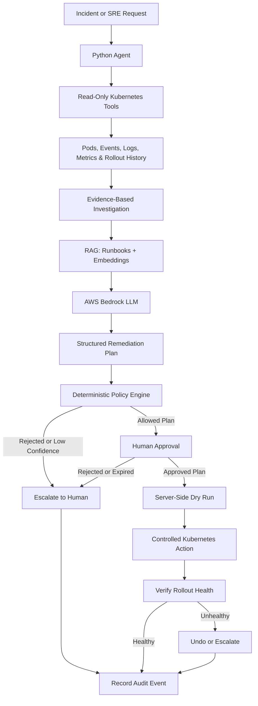

# AI Kubernetes SRE Agent

**An AI-assisted Kubernetes incident investigation and controlled remediation platform built with AWS Bedrock, RAG, Python, and Kubernetes.**

The agent investigates Kubernetes incidents, gathers operational evidence, retrieves relevant runbooks, and proposes structured remediation plans. Changes require explicit human approval before execution.

The goal is to demonstrate how AI can support SRE and platform engineering without giving an LLM unrestricted control over infrastructure.

**Focus areas:** AI Platform Engineering · Agentic AI · AWS Bedrock · Kubernetes · RAG · SRE Automation · Security & Governance

---

## Architecture



### How it works

1. **Investigate:** Collect relevant Kubernetes state through bounded, read-only tools.
2. **Retrieve context:** Search runbooks using embeddings and retrieval-augmented generation (RAG).
3. **Reason:** Use AWS Bedrock to produce a structured plan supported by collected evidence.
4. **Enforce policy:** Validate proposed actions against deterministic rules, namespace boundaries, and configured safety limits.
5. **Request approval:** Require an explicit, time-limited approval tied to the exact plan.
6. **Execute carefully:** Perform a server-side dry run before executing approved actions.
7. **Verify and audit:** Check rollout health, undo eligible changes or escalate failures, and record an auditable history.

---

## Key engineering capabilities

### Agentic AI and RAG
- Uses AWS Bedrock for LLM reasoning and tool use.
- Creates embeddings using Amazon Titan Embeddings.
- Retrieves relevant runbooks to ground incident analysis.
- Supports an optional Amazon Bedrock Knowledge Base.
- Requires evidence references in the proposed root-cause analysis.

### Kubernetes SRE automation
- Inspects pods, events, logs, deployments, nodes, and rollout history.
- Separates investigation from remediation.
- Uses structured plans instead of unrestricted natural-language execution.
- Limits supported actions through explicit policy rules.
- Verifies rollout health after eligible changes.

### Security and governance
- **Human-in-the-loop:** No remediation without the required approval.
- **Deterministic policy enforcement:** The model cannot independently expand the permitted action set.
- **Least privilege:** Kubernetes permissions separate read-only investigation from explicitly permitted write actions.
- **Sensitive-data redaction:** Scrubs supported secrets and credentials from model inputs and audit data.
- **Prompt-injection resistance:** Treats logs, events, and retrieved documents as untrusted input.
- **Approval integrity:** Uses HMAC-signed approvals with expiry and plan-hash binding.
- **Audit integrity:** Maintains hash-chained JSONL audit records with a verification command.
- **Workload hardening:** Includes non-root execution, a read-only root filesystem, and restricted egress configuration.

> Security note: This is a reference implementation, not a claim of production certification. The current shared HMAC-secret design should be replaced with a stronger separate approval trust boundary for production use.

---

## Technology stack

| Area | Technologies |
|---|---|
| Application | Python |
| Agent and tool orchestration | Structured LLM tool use |
| Foundation models | AWS Bedrock |
| Embeddings | Amazon Titan Embeddings |
| Retrieval | RAG, local runbook index, optional Bedrock Knowledge Base |
| Infrastructure target | Kubernetes |
| Identity and access | Kubernetes RBAC, AWS IAM / IRSA configuration |
| Safety | Policy engine, human approval, dry-run validation |
| Auditability | Hash-chained JSONL audit log |
| Quality | Pytest-based automated tests |
| Packaging | Python package and Docker |

---

## Quick start

### 1. Clone the repository

```bash
git clone https://github.com/venkateshusdevops/ai-agent-k8s.git
cd ai-agent-k8s
```

### 2. Install the project

Use a virtual environment where appropriate, then install the package and development dependencies:

```bash
pip install -e ".[dev]"
```

### 3. Configure the environment

Copy `.env.example` to `.env` and configure the required AWS Bedrock model, region, and other project settings.

On Windows PowerShell:

```powershell
Copy-Item .env.example .env
```

On macOS/Linux:

```bash
cp .env.example .env
```

Configure AWS credentials using your organization's approved method. Enable access to the selected Bedrock model and Titan Embeddings in the chosen AWS region.

**Never commit `.env` files, AWS credentials, tokens, or approval secrets.**

### 4. Run the tests

```bash
pytest
```

The repository includes tests for areas such as policy enforcement, redaction, approval, and audit verification.

### 5. Index the runbooks

```bash
k8s-agent index
```

This prepares the runbook index using Titan embeddings.

### 6. Investigate a Kubernetes incident

```bash
k8s-agent investigate "web pods restarting in apps" -n apps -w web
```

The investigation path is intended to collect evidence without changing cluster resources.

### 7. Request a remediation plan

```bash
k8s-agent fix "web pods restarting in apps" -n apps -w web
```

The remediation workflow requires the configured human-approval process. Review the proposed plan and its permissions before approving any action.

### 8. Verify the audit log

```bash
k8s-agent verify-audit
```

Refer to `.env.example`, the deployment manifests, and the source code for the exact configuration and permission requirements.

---

## Repository structure

```text
ai-agent-k8s/
├── src/
│   └── k8s_agent/     # Agent, tools, policy, RAG and audit logic
├── tests/             # Automated tests
├── deploy/            # Kubernetes and AWS deployment configuration
├── runbooks/          # Operational knowledge used by RAG
├── Dockerfile         # Container build
├── pyproject.toml     # Python package and tooling configuration
├── .env.example       # Environment configuration template
└── README.md
```

---

## Architecture decisions

**Why use RAG?**  
Kubernetes incidents need environment-specific operational context. Retrieving relevant runbooks provides supporting information instead of relying only on the model's general training.

**Why separate the policy engine from the LLM?**  
An LLM can propose a useful action, but deterministic code must decide whether that action is permitted. This reduces the risk of unexpected or out-of-scope operations.

**Why require human approval?**  
Infrastructure changes can affect availability. An explicit approval step gives an operator the opportunity to review the plan before execution.

**Why verify after remediation?**  
An accepted API request does not guarantee that an application recovered. Checking rollout health helps detect unsuccessful changes and trigger an undo or escalation path where supported.

**Why maintain an audit trail?**  
Incident response needs traceability: what was investigated, which plan was proposed, what was approved, and what happened afterward.

---

## Current scope and future improvements

This project is a hands-on implementation of AI-assisted Kubernetes incident response. Its behavior and safety guarantees are limited to the implemented tools, policies, deployment configuration, and tests.

Potential next steps:

- Integrate Alertmanager or EventBridge for automated incident triage.
- Add an independent approval service using SSO and asymmetric signing.
- Expand integration tests against a disposable Kubernetes cluster.
- Add evaluation datasets for root-cause accuracy and remediation-plan quality.
- Measure investigation latency, retrieval quality, approval time, and remediation success rate.
- Add operational dashboards for model usage, cost, errors, and audit events.

---

## About the author

I work across cloud infrastructure, DevOps, Kubernetes, platform engineering, and AI-enabled operations. This project explores how agentic AI can be integrated into infrastructure workflows with explicit controls for security, reliability, and human oversight.

**GitHub:** [@venkateshusdevops](https://github.com/venkateshusdevops)

**Project:** [ai-agent-k8s](https://github.com/venkateshusdevops/ai-agent-k8s)
